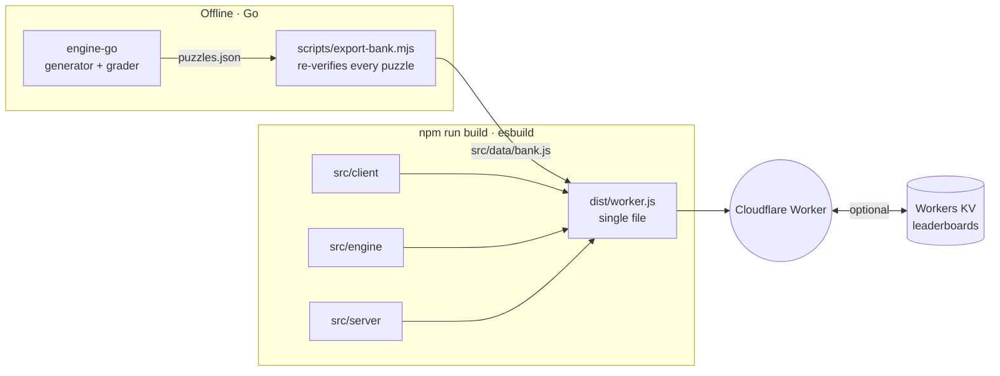

# The Daily Sudoku

Four new Sudoku puzzles every day, graded by the logic techniques they need.
Hints explain the next deduction. Finished games are replayed on the server
before they reach the leaderboard. The whole app (API, engine and UI) ships as
**one file** that runs on Cloudflare Workers' free plan.

- **Daily challenge:** Easy, Medium, Hard and Expert, the same for everyone, numbered like a newspaper puzzle
- **Explained hints:** the server runs a human-style solver and returns the technique, the pattern cells and the chain of eliminations ("after this X-Wing, r4c2 is a naked single")
- **Verified leaderboard:** the server replays the move log, checks timing, ranks results and shows where you fall in the day's solve-time distribution
- **Archive and practice:** every past daily stays playable, plus unlimited unranked practice
- Pencil notes, undo/redo, conflict marking, full keyboard control, pause, streaks, stats, light/dark themes, works on phones

## Architecture



```
src/
  engine/     shared by server and browser
    geometry.js   units, peers, adjacency tables
    board.js      parse/format, rule-conflict detection
    solver.js     bitmask MRV backtracking, uniqueness check
    logic.js      human techniques: singles → locked candidates → subsets → X-Wing, XY-Wing, Swordfish
    rng.js        sfc32 PRNG, xmur3 hashing
    transform.js  grade-preserving symmetries
  server/
    app.js        routing, rate limits, static assets, CSP
    api.js        daily, session, hint, submit, leaderboard
    puzzles.js    deterministic daily/practice derivation
    crypto.js     HMAC-signed stateless sessions
    replay.js     server-side move replay and timing checks
    leaderboard.js KV or in-memory leaderboard with histogram percentiles
  client/       no-framework SPA (router, game state, board view, dialogs)
  data/bank.js  400 graded puzzles exported from the Go engine
engine-go/      original Go engine: generator, grader, CLI, JSON-backed API
scripts/        build, dev server, bank export
test/           node:test suites (engine, API, replay, client state)
```

### Design decisions

**Puzzles cost no CPU.** Generating and grading an expert puzzle takes far
longer than the free plan's 10 ms CPU limit. So the Go engine generates and
grades a bank offline, and the Worker derives each puzzle at request time:
`HMAC(secret, "d:2026-11-23:hard")` seeds a PRNG that picks a bank entry and a
random symmetry (digit relabelling, row/column swaps within bands, band swaps,
transpose). That gives about 10¹² variants per puzzle. Every technique is
symmetric under these operations, so the grade carries over, and the tests
check that it does. Without the secret nobody can predict tomorrow's grid, and
nothing needs storing.

**Sessions don't need a database.** Starting a game returns a signed token
(puzzle id, start time, nonce, hints used). Hints return a new token with the
count incremented. The solution never reaches the browser.

**Results are replayed, not trusted.** The client records every value change
as `[cell, digit, ms]`. On submit the server replays the log from the givens.
It must end on the solution, stay in time order, never overwrite a given, and
fit inside the server-measured session time. Solves faster than 250 ms per
empty cell are verified but left off the leaderboard. Each token's nonce can
score only once.

**Hints teach.** `nextPlacement()` steps the logic solver forward from the
player's board until it reaches a placement, collecting the elimination steps
on the way. The UI highlights the pattern, strikes out the eliminated
candidates and lets the player apply them. If the board has a wrong digit, the
hint points to it instead.

**Two engines that agree.** The JavaScript solver ports the Go grader. A test
grades all 400 bank puzzles with both and requires the same hardest technique
for each one. Another test replays every deduction against the true solution
to check it is sound.

## Run locally

Requires Node 20+.

```bash
npm install
npm run dev        # builds and serves http://localhost:8787, rebuilds on change
npm test           # 31 tests
```

## Deploy (free)

**Option A: paste one file.** Run `npm run build`. In the Cloudflare dashboard,
go to Workers & Pages → Create → Worker, open the editor, replace the code
with the contents of `dist/worker.js`, and deploy. Then under Settings →
Variables add `SESSION_SECRET` (any long random string) as a secret.

**Option B: wrangler.**

```bash
npx wrangler secret put SESSION_SECRET
npm run deploy
```

For leaderboards that survive restarts, create a KV namespace, bind it as
`LEADERBOARD` (see `wrangler.toml`), and the app uses it automatically.
Without the binding, leaderboards live in isolate memory.

| Variable | Purpose |
| --- | --- |
| `SESSION_SECRET` | Signs sessions and seeds the daily puzzles. Required in production |
| `LAUNCH_DATE` | First daily (`YYYY-MM-DD`), which is No. 1. Default `2026-11-01` |
| `LEADERBOARD` | Optional KV namespace binding |

## API

| Endpoint | Description |
| --- | --- |
| `GET /api/daily?date=` | The day's four puzzles: level, required technique, clue count. No grids |
| `POST /api/session` | `{mode: "daily", date, level}` or `{mode: "practice", level}` returns `token`, `puzzle` |
| `POST /api/hint` | `{token, board}` returns the next placement with an explanation, or the first wrong cell, plus a new token |
| `POST /api/submit` | `{token, moves, elapsed, name}` replays and verifies the game, returns rank, percentile and histogram |
| `GET /api/leaderboard/:date/:level` | Top 20 and the solve-time histogram |

Dates after tomorrow (UTC) return `403`, so upcoming puzzles can't be
previewed. Only yesterday through tomorrow are ranked, which covers every
timezone's "today".

## Growing the puzzle bank

```bash
cd engine-go
go run . pool --count 200 --replace   # generate and grade with the Go engine
cd .. && npm run bank && npm run build
```

Every exported puzzle is checked for a unique solution and re-graded by the
JavaScript engine. The export fails on any disagreement.
